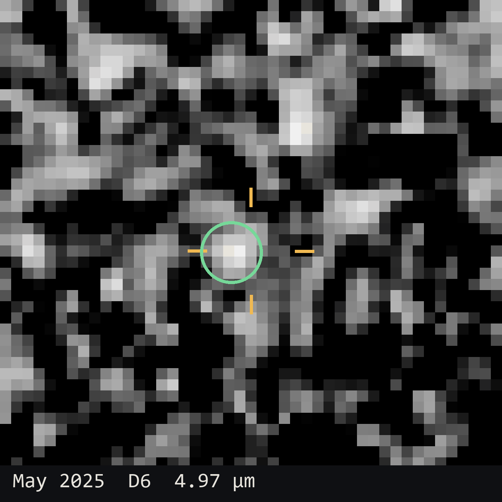
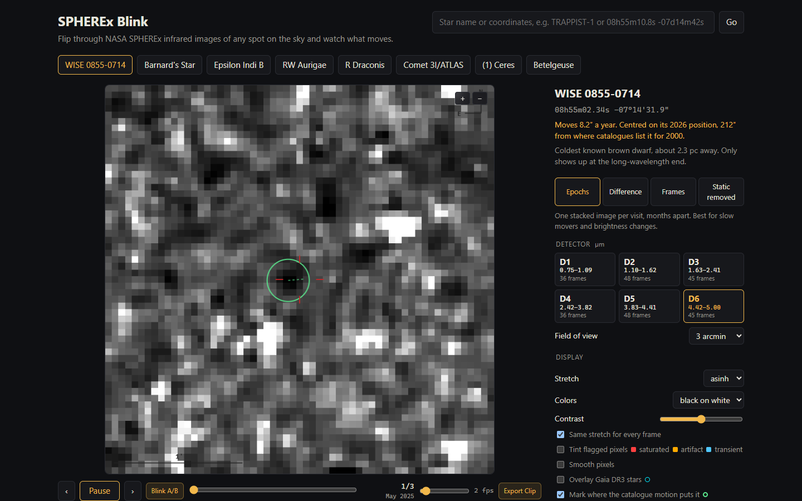
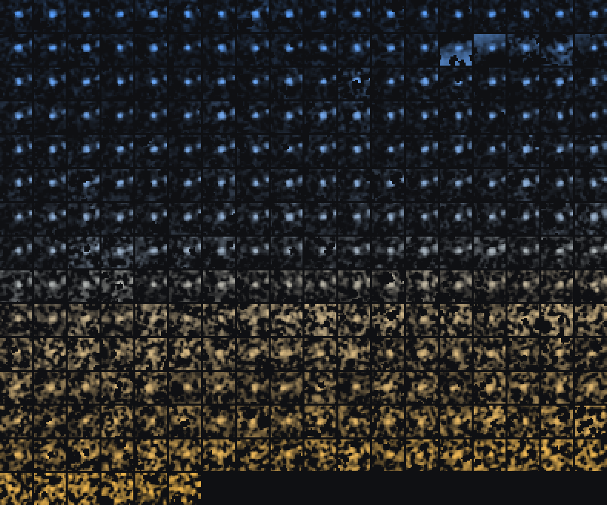

# SPHEREx Blink

Type a star name or coordinates and flip through every image NASA's SPHEREx
telescope has taken of that spot. Anything that moved or changed brightness
between visits jumps out.

**Live:** [spherexblink.vercel.app](https://spherexblink.vercel.app) &nbsp;·&nbsp;
**Pitch deck:** [PDF](https://spherexblink.vercel.app/SPHEREx_Blink_SkillIssue.pdf),
[PowerPoint](https://spherexblink.vercel.app/SPHEREx_Blink_SkillIssue.pptx)

Built in 48 hours at NASA Space Apps 2026 for the *Planet X and SPHEREx*
challenge by team Skill-Issue (Delhi): Arnav Aggarwal and Soumil Saini.

<p align="center">
  
</p>
<p align="center"><sub>WISE 0855-0714, the coldest brown dwarf known, in three SPHEREx visits between May 2025 and May 2026 (detector D6, 4.7 to 5 µm). Watch the ring.</sub></p>

## Why we built it

Clyde Tombaugh found Pluto in 1930 by flicking between two photographs of the
same stars until one dot jumped. From 2017, volunteers on Backyard Worlds did
the same with NASA's WISE images and found more than 3,000 brown dwarfs, many
of them with WiseView, a flipbook tool one of the volunteers wrote.

WISE stopped observing in 2024, when its NEOWISE mission ended. SPHEREx now
photographs the whole sky every six months in 102 colours, so it is the survey
to blink next. Its images come as 66 MB files behind an archive query language,
though, and there was no flipbook for them. We built one.



## What it does

- **Search** by name (resolved through CDS Sesame) or by RA/Dec in decimal or
  sexagesimal. Fast movers like Barnard's Star are centred on where they are
  in 2026, not where catalogues list them for 2000.
- **Four views** of the same patch:
  - *Epochs*: one stacked image per visit. SPHEREx comes back to each part of
    the sky about every six months, so this is the view for slow movers and
    brightness changes.
  - *Difference*: each visit minus a reference visit. A moving object shows
    up as a dark/light pair.
  - *Frames*: every single exposure, in time order or sorted by wavelength.
  - *Static removed*: single exposures minus the median sky.
- **Any of the six detectors** (0.75 to 5 µm) and a 3, 6, 12 or 20 arcmin field.
- **A spectrum from every exposure.** SPHEREx's filters change wavelength
  across the detector, so each exposure sees the target at a slightly
  different wavelength. Measuring the target in all of them gives a 0.75 to
  5 µm spectrum per visit. When visits disagree at the same wavelength, the
  source changed.
- **Measured motion.** The target is located in each visit stack and a straight
  line is fitted through the positions. That gives a proper motion you can
  compare with the catalogue value, which is drawn as a track on the image.
- **Gaia DR3 overlay.** Stars from ESA's Gaia catalogue are circled on the
  image, so you can tell known stars from everything else.
- **NEOSSat cross-match.** Lists observations of the same field by the Canadian
  Space Agency's NEOSSat telescope, from the CADC archive.
- **Blink like it's 1930.** A/B blink between two frames, pan and zoom, Space
  to pause, arrow keys to step, and export the loop as a WebM clip.
- **Flags.** Pixels SPHEREx marked as saturated, ghosts/artifacts or transients
  can be tinted, bad pixels are dropped, and transients are left out of stacks.
- **Share and embed.** The URL holds the target, detector, view and field, so a
  link opens the same thing. `/embed?...` is a stripped-down player for an iframe.

## Try these

| Target | Opens with | What to look for |
|---|---|---|
| WISE 0855-0714 | D6, 3′ | Coldest known brown dwarf. Invisible at short wavelengths, clear at 4 to 5 µm, moves about 8″ a year west. |
| Barnard's Star | D4, 6′ | Over 10″ a year north. The core saturates, so its position comes from the blanked-out centre. |
| Epsilon Indi B | D4, 6′ | Brown dwarf pair. Its brightness swings with wavelength inside D4 (methane band at 3.3 µm). |
| RW Aurigae | D3, 6′ | Young star whose disk keeps dimming it. Compare visits in the spectrum. |
| R Draconis | D3, 6′ | Mira variable near the north ecliptic pole, so it has many more visits than anything else. |
| Comet 3I/ATLAS | D4, 6′ | Interstellar comet. The preset is one fixed point on its path, so step through single exposures in the Frames view. |
| (1) Ceres | D3, 6′ | The largest body in the asteroid belt, at its position during SPHEREx's first survey. |
| Betelgeuse | D3, 6′ | Red supergiant in Orion and a pulsating variable. Bright enough to saturate. |

## Results on real data

Proper motions the app measured from public SPHEREx images (DR1 and QR3),
next to the catalogue values:

| Target | Measured | Catalogue |
|---|---|---|
| WISE 0855-0714 (D6) | RA: -7.9 ± 1.0″/yr | -8.1″/yr |
| Barnard's Star (D4) | Dec: +8.9 ± 1.2″/yr | +10.4″/yr |
| Epsilon Indi B (D4) | RA, Dec: +3.5, -2.2 ± 0.9″/yr | +4.0, -2.5″/yr |

Three visits over one year are good to about 1″/yr, so the measurement is only
useful for fast movers. Barnard's Star saturates, so it has to be located
from its blanked-out core.

The Epsilon Indi B spectrum (247 clean points from 4 visits) shows the deep
methane dip near 3.3 µm that marks a cold brown dwarf rather than a star.

## How it works

```
browser ──/api/search──► IRSA TAP (spherex.plane + spherex.artifact)
        ──/api/frames──► HTTP range requests into each Level 2 image on IRSA
                          └► reproject onto a north-up grid, co-add per visit
        ──/api/spectrum► aperture photometry in every exposure, all detectors
        ──/api/motion──► gaussian centroids in each visit stack
```

**Finding images.** One ADQL query against IRSA's `spherex.plane` and
`spherex.artifact` tables returns every Level 2 spectral image whose footprint
contains the position. When the same exposure is in more than one release, the
DR1 version wins over the weekly QR3 one. Exposures are grouped into visits
wherever there is a gap of more than 30 days, and continuous stretches longer
than 60 days (near the ecliptic poles) get split into separate visits.

**Reading only what we need.** Each Level 2 file is about 66 MB (2040×2040
image, flags, variance, zodiacal model, PSF cube, wavelength table). Instead of
downloading files or using the cutout service, the backend sends HTTP
multi-range requests for the header blocks, the image rows around the target,
the compressed flag rows and the wavelength table at the end of the file. That
is three or four round trips per exposure, and 368 KB for a 3′ field. The
result matches IRSA's own cutouts pixel for pixel.

<p align="center">
  
</p>
<p align="center"><sub>All 258 SPHEREx exposures of WISE 0855-0714 across the six detectors, sorted by wavelength from 0.75 µm (blue) to 5 µm (amber). Downloading the files whole would take about 17 GB. For a 3′ field the app reads about 95 MB.</sub></p>

**Making the movie.** Each cutout is background-subtracted, then resampled with
its own WCS onto a common north-up, east-left grid centred on the target.
Visit stacks are inverse-variance weighted means with robust 3σ MAD clipping,
so cosmic rays and satellite trails drop out. Every frame keeps its wavelength,
which is read from the file's spectral WCS at the target position.

**Display.** Frames go to the browser as raw float32 arrays (a small binary
format, see `backend/app/wire.py`) so stretch, contrast and colour map change
instantly without another request.

Everything the backend fetches is cached on disk. `demo_cache/` holds the
search results, stacks, spectra, Gaia stars and NEOSSat matches for the
presets, so they open instantly even if IRSA is slow.

## Run it locally

Backend (Python 3.11+):

```bash
python -m venv .venv
.venv/Scripts/pip install -r backend/requirements.txt    # .venv/bin/pip on mac/linux
.venv/Scripts/python -m uvicorn app.main:app --app-dir backend --port 8000
```

Frontend, in another terminal:

```bash
cd frontend
npm install
npm run dev
```

Then open http://localhost:5173. Vite proxies `/api` to the backend.

Tests: `.venv/Scripts/python -m pytest backend/tests`

## Deploy

**Vercel** runs the live site. `vercel.json` builds `frontend/` as static files
and runs the whole FastAPI app as one Python function through `api/index.py`,
with `requirements.txt` at the repo root. Only `/tmp` is writable there, so the
cache goes to `/tmp/blink-cache`. Vercel also refuses responses over 4.5 MB,
so `BLINK_MAX_BYTES=4000000` thins the single-exposure views to fit.

```bash
vercel deploy --prod
```

**Docker** works anywhere else (the image is set up for Hugging Face Spaces).
The backend serves the site on port 7860:

```bash
docker build -t spherex-blink .
docker run -p 7860:7860 spherex-blink
```

### Settings

| Variable | Default | |
|---|---|---|
| `SPHEREX_RELEASES` | `dr1,qr3` | Release preference order. New releases are picked up even if not listed. |
| `BLINK_CACHE` | `./cache` | Where search results, cutouts and stacks are cached. |
| `BLINK_WORKERS` | `16` | Parallel requests to IRSA. |
| `BLINK_MAX_BYTES` | `0` (no cap) | Largest single-exposure response, for hosts with a size limit. |

### Keeping up with new data

SPHEREx publishes new quick-release images every week. Search results are
cached for 24 hours, so new visits show up within a day without anything being
redeployed. `GET /api/search?ra=..&dec=..&fresh=true` forces a fresh query, and
`python scripts/prebake.py` rebuilds the demo cache.

## API

| Endpoint | Returns |
|---|---|
| `GET /api/resolve?q=` | Position, proper motion and parallax for a name or coordinate string |
| `GET /api/targets` | The preset targets |
| `GET /api/search?ra&dec` | Every exposure covering the position, grouped into visits |
| `GET /api/frames?ra&dec&det&view&fov&ref` | Image stack in the SPXF binary format |
| `GET /api/spectrum?ra&dec&pmra&pmdec` | Forced photometry in every exposure (JSON) |
| `GET /api/motion?ra&dec&det&fov&pmra&pmdec` | Per-visit centroids and fitted proper motion |
| `GET /api/gaia?ra&dec&fov` | Gaia DR3 stars in the field with G-band magnitudes |
| `GET /api/neossat?ra&dec&fov` | CADC CAOM-TAP observations for CSA NEOSSat |

## Limitations

- Spectrum fluxes are summed in a fixed 12″ aperture with no aperture
  correction. SPHEREx pixels are 6.15″, so a neighbouring star inside that
  radius adds its light (WISE 0855's blue end is mostly a background star).
- Very bright stars saturate. Their points are flagged and hidden in the
  spectrum by default.
- The catalogue track ignores parallax, which is under 0.6″ for every preset.
- Motion measured from three visits over one year is good to about 1″/yr.
  Only trust it for fast movers.
- On Vercel the first request after a quiet spell starts a fresh Python
  function, so it can take several seconds longer.

## Data and credits

This uses data from [SPHEREx](https://science.nasa.gov/mission/spherex/)
(Spectro-Photometer for the History of the Universe, Epoch of Reionization and
Ices Explorer), a NASA mission led by Caltech and managed by JPL, served by the
[NASA/IPAC Infrared Science Archive](https://irsa.ipac.caltech.edu/Missions/spherex.html)
(IRSA). Names are resolved with [CDS Sesame](https://cds.unistra.fr/cgi-bin/Sesame)
(SIMBAD, NED, VizieR). Gaia DR3 stars come from the
[ESA Gaia archive](https://gea.esac.esa.int/archive/), and NEOSSat observations
from the [Canadian Astronomy Data Centre](https://www.cadc-ccda.hia-iha.nrc-cnrc.gc.ca/).
The idea comes straight from [WiseView](http://byw.tools/wiseview) and the
[Backyard Worlds](https://www.zooniverse.org/projects/marckuchner/backyard-worlds-planet-9)
volunteers.

Built with Astropy, NumPy, SciPy, PyVO, FastAPI, React and Vite. More detail on
the data in [docs/data.md](docs/data.md).
